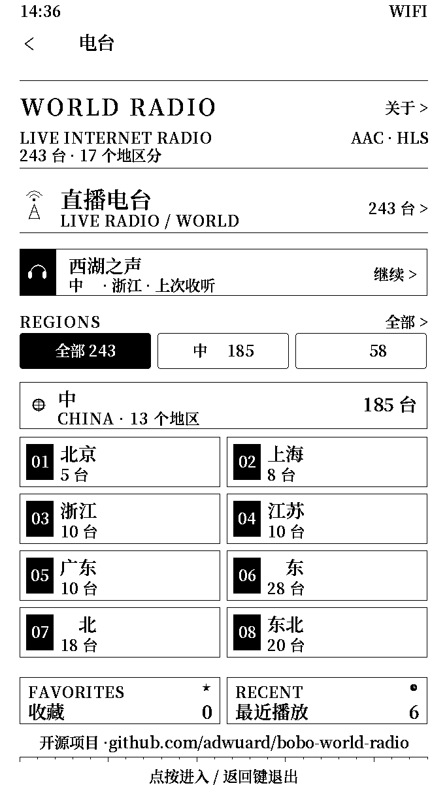
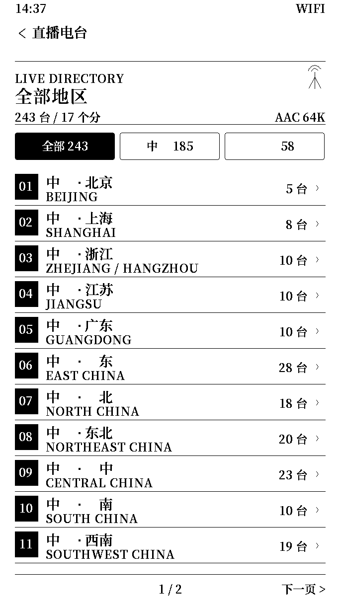
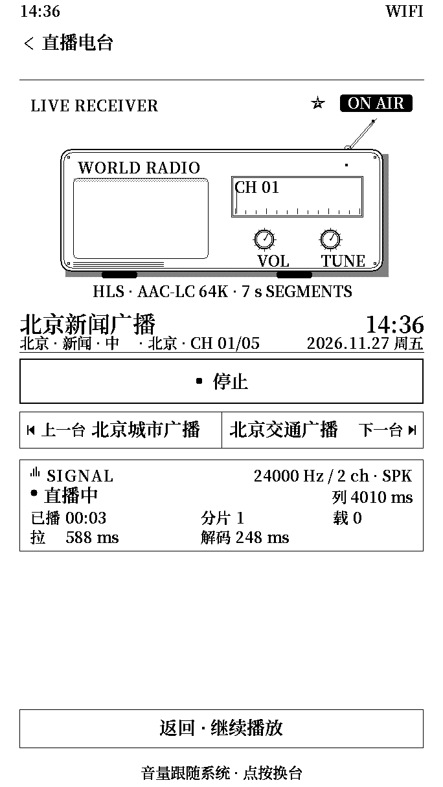

# 环球电台 · World Radio

**243 家直播电台，此刻正在播出。**

从北京交通广播到 BBC World Service，一块墨水屏装下世界的声音。没有点播、没有下载、没有音频文件随包分发——只有真实的 HLS 直播流，按下播放，听到的就是电台正在播出的这一刻。

BoBo 墨水屏 ELF 原生应用（API 6），同一套界面适配 3.97 寸 480×800 与 4.7 寸 Plus 684×1216。

开源项目 · Now Open Source：**github.com/adwuard/bobo-world-radio**

## 截图

<table>
  <tr>
    <td align="center" width="33%"><br><sub>首页 · Home</sub></td>
    <td align="center" width="33%"><br><sub>地区目录 · Regions</sub></td>
    <td align="center" width="33%"><br><sub>直播播放页 · Player</sub></td>
  </tr>
</table>

*4.7 寸 Plus 设备实拍，由应用内「右下角连点 10 次」生成。*

## 亮点

- **一次收藏，全球在耳** — 中国（含港澳台）185 家、国际 58 家，共 243 家直播电台、17 个地区分组。列表与播放页右上角都能点星收藏，中空 / 实心一眼可辨，底部提示条即时确认。
- **为墨水屏重写的电台界面** — 字标、规则线与充足留白；1-bit 矢量图标和手绘收音机插画，无位图、无黑底重块，静止时干净，刷新时利落。
- **一个键启停，一条文字换台** — 播放与停止合并为同一个主按键，图标与文字随状态切换；换台条直接写出上一台、下一台台名，点哪去哪。
- **蓝牙耳机也从容** — 开声前按路由预充缓冲（耳机 3.5 秒、扬声器 2 秒）；扬声器与耳机之间切换时自动清空旧队列、重开输出、重新预充，听不到「卡死」。
- **离开播放页，声音不断** — 浏览电台列表、地区分组和关于页时直播继续播；返回键写着「返回 · 继续播放」，列表与首页用「正在播放 / ON AIR」标记当前电台。停止、退出应用或锁屏仍会停下——固件目前只允许前台应用出声，后台音频的官方接口已写入 `NEEDS.md`。
- **回来接着听** — 记住上次的电台与页面；冷启动直接回到播放页并续上直播，「继续收听」一触即达。
- **右下角连点 10 次，截屏进 TF 卡** — 固件没有读屏接口，应用就在内存里把当前页重画一遍：1-bit BMP 存到 TF 卡上的应用目录 `user/shots/shot-001.bmp` 起，更新不丢。右下角是手势区，连点时不会误触返回、翻页或收藏。
- **音量与语言都跟着你** — 音量完全跟随系统，应用不再另设一套；界面支持中文 / English 一键切换。

## 电台目录

| 区域 | 台数 |
| --- | ---: |
| 中国 · 大陆（蜻蜓 HLS） | 180 |
| 中国 · 港澳台（RTHK、RTI） | 5 |
| 国际（公共广播 HLS） | 58 |
| **合计** | **243 家 / 17 个分组** |

- **大陆 180 家**：北京 5、上海 8、浙江 10（杭州 7）、江苏 10、广东 10、华东 28、华北 18、东北 20、华中 23、华南 10、西南 19、西北 19；蜻蜓 HLS，AAC-LC 64 kbps、7 秒分片。
- **港澳台 5 家**：RTHK 2/3/4/5、RTI 台湾之音。
- **国际 58 家**：BBC World Service 与 Radio 1–6、NHK World、WDR 3/5、MDR Jump、hr-info、NRK、DR、Yle、ORF、RTÉ、RNE、Rai Classica、SR、RDP、Antena、TRT、VOV、MCOT、CBC、WGBH、ABC 等。

## 技术一览

固件只提供「完整响应」式 HTTPS 与 PCM 输出，没有流式接口；直播因此建立在 HLS 的有限分片之上：

**播放链路** — HLS 播放列表 → 已完成分片 →（按需）MPEG-TS 解复用 → Helix AAC-LC 解码 → 宿主 PSRAM 环形缓冲 → 扬声器 / 蓝牙。已列分片顺播，窗口滑动时提前刷新列表，落后则跳到最新段；以 7 秒分片换取稳定，而不是依赖无限长的 HTTP 响应。

**蓝牙与输出路由** — 播放时以 4 Hz 轮询输出路由，SPK ↔ BT 变化需连续稳定 300 ms 才动作；随后丢弃旧队列、按新路由重开输出并重新预充。另有出声看门狗：已播位置 4 秒不动且仍有排队音频时自动重启输出。

**墨水屏与交互** — 播放是独立于页面的会话：主循环常驻驱动 `live_service()`，播放页只是它的一个视图，离开页面只换视图、不停声音；点按其他电台或播放键会等当前分片收尾后安全切换，不会在解码中途更换缓冲。播放中整屏刷新降为每 30 秒一次，状态变化与按键即时重绘；每个解码帧与每次网络请求前后都处理按键，返回键与页头箭头最多等一个请求，不用等一整段播完。

**截屏** — API 8 没有给应用读屏或截屏的接口，所以截图是「重建」的：连点右下角（64/80 px 见方，相邻点按 ≤ 1.6 秒，10 次触发）后，应用把当前页的所有绘制调用原样再执行一遍，只是输出到一块 1:1 的 1-bit 影子画布，然后手写 62 字节 BMP 头、按 BMP 的自下而上行序把 480×800 或 684×1216 的位图写入 `user/shots/shot-NNN.bmp`（应用目录，物理位置在 TF 卡，更新应用不丢；序号 1–999 循环）。文字用固件同一套排版前进量（`bobo_text_advance`），字形来自随包的 `files/uifont-480.bin` / `uifont-684.bin`——它们是用固件自带的 Lua 渲染器按真字体逐字渲染后打包的，所以截图里的换行、断行与屏幕一致；页头状态栏是应用重绘的（时钟、WIFI、箭头、标题、分隔线）。影子画布与字形表在每次截屏后释放，不占播放时的内存；底部提示条不会进入截图。

**体积与内存** — 应用任务栈仅 12 KB：所有大缓冲放在静态区，最深调用链约 1.3 KB，启动即恢复直播时约 1 KB。安装包约 330 KB（其中 200 KB 是截屏字形表），ELF 约 103 KB（限 512 KB）。截屏时临时申请约 144 KB（3.97 寸）/ 267 KB（4.7 寸），写完即释放。

## 构建与安装

需要 SDK 2026.11.19 或更新版本（API 6），已在 2026.11.26（API 8）上验证；两套交叉编译器就绪（工作区 `~/Documents/Bobo/env.sh`）。

```
bobo check                 # 两个目标板都会编译并做商店同款检查
bobo pack                  # dist/world-radio-0.9.2.zip
bobo import --to <IP>      # 设备上打开 应用商店 › 导入 › 网页导入
bobo push . --run          # 或 USB + 开发者模式
```

截屏字形表由 `tools/gen_atlas.py` 生成（用 SDK 里的固件同款 Lua 渲染器逐字渲染；改了界面文案后重跑一次）：

```
python3 tools/gen_atlas.py          # 重写 files/uifont-480.bin 与 uifont-684.bin
```

设备自检要点：冷启动从播放页自动续播不崩溃；播放/停止单键切换顺手；播放中返回列表，声音不断、列表与首页显示「正在播放」，再进播放页状态一致；列表行右侧星标点按后变实心、底部出现「已收藏 · 台名」，再点变回中空并提示「已取消收藏」；播放页右上角星标与列表状态一致；换台条左右换台并自动接流；蓝牙耳机切换输出后能重新出声；返回键在取流时也立即生效；在任意页面连点右下角 10 次，底部提示「已截屏 · shot-NNN」，TF 卡 `user/shots/` 里能用看图软件打开 1-bit BMP 且与屏幕同向、内容一致；连点期间页面不翻页、不退出播放页。

## 目录格式与源码

`files/live.tsv`：UTF-8、Tab 分隔、`#` 注释，同一分组的行必须连续；`source` 为 `qt:<蜻蜓id>` 或完整 m3u8 地址。

```
中国 · 浙江	FM93浙江交通之声	杭州 · 交通	qt:4522
国际 · 欧洲	BBC World Service	London · News	https://a.files.bbci.co.uk/ms6/live/.../bbc_world_service.m3u8
```

```
src/main.c                 界面、目录解析、导航、直播播放器、截屏影子画布
src/third_party/helix/     Helix AAC-LC 解码器（RPSL，LICENSE 随附）
files/live.tsv             直播电台表（243 家、17 分组）
files/uifont-480.bin       截屏字形表：3.97 寸，SMALL/BODY/TITLE × 542 字
files/uifont-684.bin       截屏字形表：4.7 寸 Plus，同上
tools/gen_atlas.py         用固件同款渲染器重新生成字形表
icon.png                   512×512 应用图标：地球 + 右下角收音机
```

运行时写入（不在安装包里）：`user/shots/shot-NNN.bmp`——TF 卡上应用目录内的 1-bit 截屏，序号存在应用状态里，跨更新保留。

## 已知限制

- 国际台地址为 2026-11-26 的公开 HLS 快照，可能因改版、地区限制或防盗链失效；失效需重新探测并更新目录。
- 直播没有暂停与回看：停止会释放扬声器与网络，再播放从最新直播点继续。
- 「跟随系统语言」目前回退为中文：API 6 没有系统语言接口，可在关于页手动选择 English；英文界面下台名仍为中文。
- fMP4/CMAF 封装的 HLS 暂不支持；加密流与 AC-3 等非 AAC 音轨不支持。
- `bobo_http` 无法中途取消：若恰好卡在一次网络请求里，返回会等该请求结束（最多为 SDK 超时）。
- 关闭 SBR 只解码 AAC-LC 核心：高频略闷，是 16 kHz 单声道扬声器下的取舍；蓝牙链路差时仍可能短暂断音。
- 没有系统后台音频：退出应用、回到桌面或锁屏即停止（固件只允许前台应用出声）；应用内离开播放页的续播已支持，跨应用后台播放的接口需求见 `NEEDS.md`。
- 截屏是应用重绘而非面板抓取：内容与布局同屏，但页头状态栏（时钟 / WIFI / 返回箭头 / 标题线）由应用按缓存高度重画，粗体按常规字重输出；提示条不进截图。
- 随包字形来自设备内置的基础字库，约 1/4 生僻汉字（国、环、球等 111 个）暂无字形，截图中为空白；把 TF 卡上的系统字库 `BoBoSerifSC-Regular.ttf` 装进模拟器（`python3 bobo-sdk/tools/luasim/system_font.py install <SD 根目录>`）后重跑 `tools/gen_atlas.py` 即可补齐。屏幕上不受影响——设备本身用系统字库显示这些字。

## 数据与版权

- 大陆台来自蜻蜓 FM 的公开 HLS 地址（第三方转播，非电台官方源）；国际台来自各广播机构公开的 HLS 入口。上架或分发前请自行确认转播授权。
- 应用不打包、不再分发音频；播放时设备直接从广播机构或转播方 CDN 取流，音频版权归各广播机构。

## 许可

- Helix AAC：RealNetworks Public Source License（RPSL），见 `src/third_party/helix/readme.txt` 与各源文件头。
- 应用代码与快照数据：未指定开源许可证，发布前请自行确定。